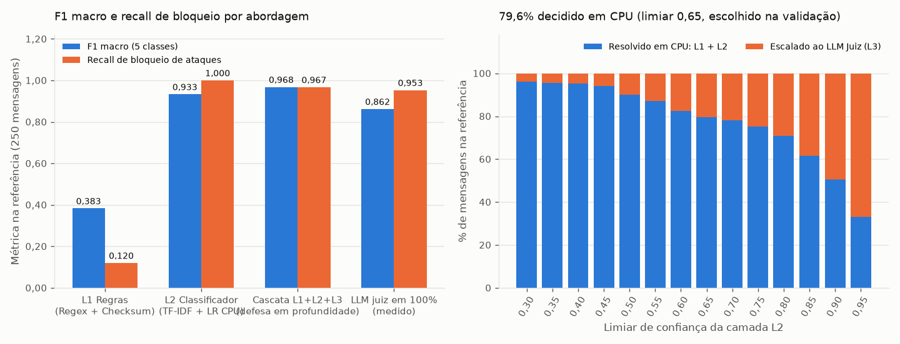
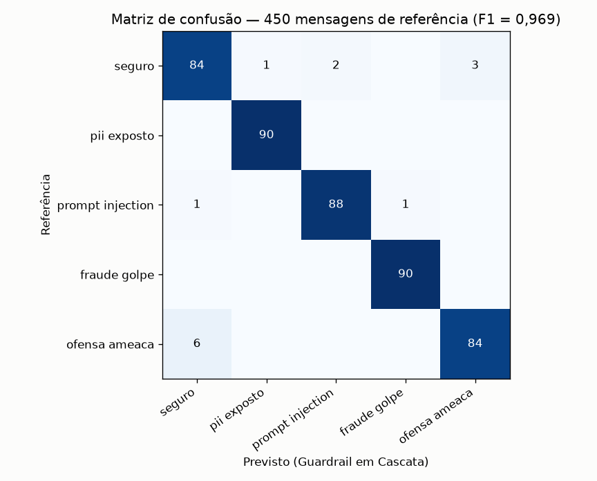
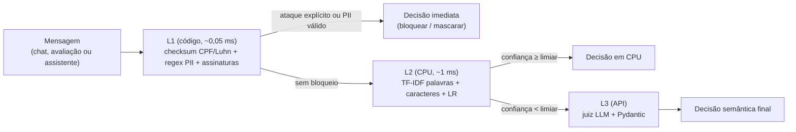

# Guardrails & Moderação em Tempo Real para Delivery

Pipeline de moderação em cascata (**regras determinísticas + classificador estatístico em CPU + juiz LLM**) para chats de entrega, avaliações de lojas e assistentes de IA: detecta *prompt injection*, tentativas de golpe, ofensas/ameaças e dados pessoais (PII), e **mascara PII antes de qualquer chamada a um LLM externo**. Resultado principal: a cascata completa chega a **F1 macro 0,968** (IC95 0,945–0,988) numa referência balanceada de 250 mensagens, mais que o LLM sozinho (0,862), com cerca de 80% das mensagens decididas na CPU em ~1 ms. Os números têm ressalvas importantes, listadas abaixo: dados parcialmente sintéticos, referência balanceada e precisão do bloqueio baixa em tráfego realista.

[](https://github.com/krosct/project-nov26-p5-guardrails/actions/workflows/ci.yml)

## O problema

Em uma plataforma com mais de 100 milhões de pedidos por mês, chats, avaliações e assistentes baseados em LLM sofrem três riscos: (1) *prompt injection*, (2) golpes e ofensas, (3) vazamento de dados pessoais (LGPD). Chamar um LLM grande para toda mensagem custa caro e leva segundos; só regras deixam passar quase tudo que não usa palavra-chave óbvia. **Como combinar latência de milissegundos, proteção determinística de PII e compreensão semântica?**

## Dados (leia antes dos números)

Detalhes e justificativas em [`data/README.md`](data/README.md).

- **Reais:** avaliações da Olist (`seguro` e base do `pii_exposto`) e tweets anotados (`ofensa_ameaca` e `seguro`; só os tweets em que os 3 anotadores concordam).
- **Sintéticos:** `prompt_injection` (dataset da comunidade gerado por LLM), `fraude_golpe` (tentativas de golpe geradas por template neste projeto) e o dado pessoal inserido em `pii_exposto` (não há PII real em bases públicas). Os números dessas classes medem a detecção de *esses* padrões, não de golpes reais.
- **`fraude_golpe` é a tentativa de golpe, não o relato.** Quem conta ter recebido produto falsificado faz uma reclamação legítima (`seguro`); as avaliações reais da Olist que citam "golpe" ou "falsificado" entram como `seguro`. Assim nenhuma palavra-chave separa as classes.
- **Sem atalho de fonte:** tweets, dataset de injeção e Olist aparecem em mais de uma classe, e o dado pessoal entra em posição e formato variados.
- **Rótulos por construção, não por anotador humano:** a referência é auditada por um juiz LLM independente (concordância e desacordos abaixo) e os desacordos aguardam revisão humana.
- 280 exemplos por classe: 200 treino, 30 validação, 50 referência, estratificados por fonte, sem duplicatas mesmo após normalizar caixa e pontuação.

## Resultados

Avaliação em **250 mensagens de referência** (50 por classe), que não participam de treino nem de nenhuma escolha. O limiar da cascata (**0,65**) foi escolhido **só na validação**, por um critério fixado antes (maior limiar com até 15% de escalonamento ao LLM; critério e candidatos em [`dominio.py`](src/project_nov26_p5_guardrails/dominio.py), resultado em [`models/limiar.json`](models/limiar.json)). Tabelas geradas por `scripts/tabela_readme.py` a partir de [`reports/`](reports/); intervalos de confiança por bootstrap (2.000 reamostragens, seed 42).

<!-- TABELA:resultados -->
| Abordagem | F1 macro (IC95) | Acurácia | Kappa | Recall de bloqueio (IC95) | Falso bloqueio (IC95) | Latência p50 / p95 | Custo / 1M msgs |
|---|---|---|---|---|---|---|---|
| L1: regras (regex + checksum) | 0,383 (0,34–0,42) | 0,448 | 0,310 | 12,0% (0,07–0,17) | 0,0% (0,00–0,00) | 0,05 ms / 0,10 ms | US$ 0,01 |
| L2: TF-IDF + regressão logística (CPU) | 0,933 (0,90–0,96) | 0,936 | 0,920 | 100,0% (1,00–1,00) | 8,0% (0,03–0,14) | — | — |
| Cascata só CPU (L1 + L2) | 0,939 (0,91–0,97) | 0,940 | 0,925 | 100,0% (1,00–1,00) | 10,0% (0,04–0,16) | 1,25 ms / 1,68 ms | US$ 0,05 |
| **Cascata completa (L1 + L2 + L3)** | 0,968 (0,94–0,99) | 0,968 | 0,960 | 96,7% (0,94–0,99) | 1,0% (0,00–0,03) | 1,28 ms / 6017,72 ms | US$ 220,25 |
| LLM juiz em 100% do tráfego (medido) | 0,862 (0,82–0,90) | 0,864 | 0,830 | 95,3% (0,92–0,99) | 0,0% (0,00–0,00) | 5100,00 ms / 10534,00 ms | US$ 1079,43 |
<!-- /TABELA:resultados -->

Latência medida em um Intel Core 5 120U; custo do LLM pelo preço da versão paga do mesmo modelo (US$ 0,60 / US$ 2,40 por milhão de tokens), com os tokens médios **medidos** nas chamadas do juiz ([`latencia_custo.json`](reports/latencia_custo.json)). A linha do LLM em 100% foi medida nas mesmas 250 mensagens (texto já redigido pela L1).

**O que os números mostram**

- **A cascata supera o LLM sozinho** (0,968 contra 0,862), sobretudo por causa de PII: o LLM em 100% recebe o texto já mascarado e acerta só 50% dos exemplos de `pii_exposto` (não vê o dado), enquanto a L1 resolve 90% deles por checksum e formato. Nas demais classes o LLM é bom (92–100% por fonte), e ele é a camada que mais ajuda nos exemplos seguros com cara de ataque. Isso é consequência do desenho (redigir antes de enviar), não defeito do modelo.
- **L1 sozinha** quase não bloqueia ataques (recall baixo), mas tem **0% de falso bloqueio** e resolve 90% dos exemplos de PII (os 10% restantes estão escritos por extenso, fora do formato).
- **L2** tem recall de bloqueio muito alto, e é nos exemplos da mesma fonte da classe oposta que ela erra (tabela por fonte abaixo): é aí que o juiz LLM ajuda.
- **Intervalos largos:** com 50 exemplos por classe, 1 erro entre `seguro` vale 2 pontos percentuais; o IC95 do falso bloqueio da cascata completa vai até ~3%.

### Atenção: o tráfego real não é balanceado

A referência tem 20% por classe. Em produção quase tudo é seguro, e então a **precisão do bloqueio despenca**: com a prevalência ilustrativa abaixo (97% seguro; é uma suposição, não uma medida), o mesmo falso bloqueio vira muitos bloqueios indevidos para cada ataque real.

<!-- TABELA:prevalencia -->
| Abordagem | Falso bloqueio (sobre `seguro`) | Precisão do bloqueio (97% de tráfego seguro) |
|---|---|---|
| Cascata só CPU | 15,9% | 11,4% |
| Cascata completa | 2,0% | 49,6% |
| LLM em 100% | 0,0% | 100,0% |
<!-- /TABELA:prevalencia -->

Ou seja: sem o juiz LLM, a cascata só CPU bloquearia por engano muito mais mensagens seguras do que ataques reais em tráfego realista (precisão do bloqueio de ~11%). A cascata completa melhora isso (~50%), mas **o LLM em 100% é melhor nesse eixo** (0 falsos bloqueios na referência), ao custo de ~5× mais caro, ~5 s de latência e de perder PII mascarado. Não há opção que vença em tudo; o que a cascata entrega é um meio-termo de custo e latência, e o próximo passo é reduzir os falsos bloqueios do L2 antes de depender dele em tráfego real.

### Acurácia por fonte (conteúdo × estilo)

Se o modelo aprendesse só o estilo da fonte, erraria as fontes que aparecem nas duas classes. `tweet_nao_ofensivo` e `pi_nao_injecao` são as fontes "do lado seguro" de tweets e do dataset de injeção; têm poucos exemplos na referência (4 e 5), então leia como indício, não como medida.

<!-- TABELA:fontes -->
| Fonte | n | L2 | Cascata CPU | Cascata completa |
|---|---|---|---|---|
| `golpe_sintetico` | 50 | 100,0% | 100,0% | 100,0% |
| `olist_com_pii_sintetico` | 50 | 96,0% | 90,0% | 100,0% |
| `olist_elogio` | 11 | 100,0% | 100,0% | 100,0% |
| `olist_numero_inocente` | 7 | 85,7% | 85,7% | 85,7% |
| `olist_pix_link_codigo` | 5 | 100,0% | 100,0% | 100,0% |
| `olist_reclamacao` | 9 | 55,6% | 100,0% | 100,0% |
| `olist_relato_fraude` | 9 | 100,0% | 100,0% | 100,0% |
| `pi_injecao_sintetica` | 50 | 98,0% | 98,0% | 96,0% |
| `pi_nao_injecao` | 5 | 0,0% | 0,0% | 80,0% |
| `tweet_nao_ofensivo` | 4 | 25,0% | 25,0% | 100,0% |
| `tweet_odio` | 50 | 100,0% | 100,0% | 92,0% |
<!-- /TABELA:fontes -->

O L2 erra quase todos os exemplos seguros que vêm da mesma fonte de uma classe de ataque (usa o estilo como atalho em parte), e a cascata completa recupera boa parte deles via juiz LLM. Isso é um limite real do L2 treinado em 200 exemplos por classe.

**Teste de atalho de fonte** ([`reports/teste_atalho_fonte.json`](reports/teste_atalho_fonte.json), `scripts/teste_atalho_fonte.py`): um classificador que só prevê a fonte do texto acerta **99,6%**, então o estilo é facilmente separável. Um baseline que ignora o conteúdo e prevê a classe mais comum de cada fonte chega a **80,0%** de acurácia na referência, contra **93,6%** do L2 (75,0% × 92,0% nas fontes que têm mais de uma classe). O L2 usa conteúdo, mas parte do resultado (até 80 pontos de 100) é explicável só pela fonte; por isso o número que importa para a qualidade real é o ganho sobre esse piso, não a acurácia absoluta.

### Auditoria dos rótulos da referência

Um juiz LLM independente (rótulo sem ver a classe) concorda com **94%** da referência (kappa **0,925**; [`reports/auditoria_referencia.json`](reports/auditoria_referencia.json)). São **15 desacordos** (9 em `tweet_odio`, 4 em injeção/`pi_nao_injecao`, 1 em PII, 1 em injeção), em [`data/referencia_revisar.csv`](data/referencia_revisar.csv), que **precisam de revisão humana**. O arquivo traz uma sugestão do assistente por linha (não substitui o anotador): 8 manter, 6 mudar para `seguro` (tweets de opinião política sem ataque a grupo, que a base marcou como ódio), 1 ambíguo; a coluna `decisao_humana` está vazia: onde o juiz está certo, o rótulo da referência é que deve mudar. Antes de usar só os tweets com consenso dos 3 anotadores, a concordância em `ofensa_ameaca` era 58%, e hoje é 84%: a maioria simples da base de origem tem muito ruído.





## Como funciona



1. **Taxonomia orientada a ação** ([`data/taxonomia.md`](data/taxonomia.md), [`dominio.py`](src/project_nov26_p5_guardrails/dominio.py)): 5 categorias (`seguro`, `pii_exposto`, `prompt_injection`, `fraude_golpe`, `ofensa_ameaca`) mapeadas para 3 ações (`permitir`, `mascarar`, `bloquear`). A mesma taxonomia é o prompt do juiz.
2. **L1, regras e redação de PII** ([`regras.py`](src/project_nov26_p5_guardrails/regras.py)): valida CPF (dígitos verificadores) e cartão (Luhn), mascara telefone, e-mail e chave Pix, e barra assinaturas inequívocas de injeção, tentativa de golpe e ameaça. Relato de golpe sofrido **não** bloqueia.
3. **L2, classificador em CPU** ([`classificador.py`](src/project_nov26_p5_guardrails/classificador.py)): TF-IDF de palavras (1–2) e caracteres (3–5) com regressão logística. Se prevê `pii_exposto` sem PII confirmado pela L1, descarta e escolhe a segunda classe.
4. **L3, juiz LLM com privacidade por construção** ([`llm.py`](src/project_nov26_p5_guardrails/llm.py), [`cascata.py`](src/project_nov26_p5_guardrails/cascata.py)): chamado só quando a confiança do L2 fica abaixo do limiar, e sempre com o texto **já redigido pela L1**.
5. **API FastAPI** ([`api.py`](src/project_nov26_p5_guardrails/api.py), [`Dockerfile`](Dockerfile)): `/health` e `/moderate` com contratos Pydantic.

## Como rodar

```bash
uv sync --group dev --group train
uv run --group train python scripts/pipeline.py      # dados → treino → avaliação → auditoria → figuras → tabelas → testes
uv run uvicorn project_nov26_p5_guardrails.api:app   # API em http://localhost:8000
```

O pipeline usa o juiz LLM (OpenRouter, modelo gratuito) em `avaliar` e `auditar`, com cache em disco; a chave fica em `.env.shared` (nunca versionada). Para refazer só uma parte: `--de <etapa> --ate <etapa>`.

```bash
curl -s -X POST http://localhost:8000/moderate -H "Content-Type: application/json" \
  -d '{"texto": "Meu pedido atrasou, faz o estorno no CPF 529.982.247-25 por favor.", "canal": "chat_entrega"}'
```

## Decisões e trade-offs

- **Cascata em vez de um modelo só:** regras são rápidas e exatas para PII, o L2 cobre a variação de escrita, o LLM desempata o ambíguo. Custo: três componentes para manter e uma latência de cauda alta (p95 de segundos) quando a mensagem cai no juiz.
- **Limiar escolhido por orçamento, não por F1 na referência:** o critério é "maior limiar com até 15% de escalonamento na validação". Na referência o escalonamento ficou mais alto (a distribuição da validação, com 150 exemplos, não é idêntica), e a curva de limiar da referência é só análise.
- **Validação por checksum** (CPF e Luhn) para não mascarar números de pedido, mas formatos escritos por extenso ("arroba", CPF com espaços) escapam da L1; o L2 e o juiz cobrem parte deles.
- **Redação antes do LLM:** o provedor externo recebe `[CPF]` e `[TELEFONE]`, não o dado. Custo: o juiz pode julgar pior quando o dado mascarado era o sinal principal (a L1 restaura `pii_exposto` quando detectou PII).

## Limitações e próximos passos

- **Dados:** parte sintética (golpe, injeção, PII) e rótulos por construção; revisar `data/referencia_revisar.csv` e, idealmente, testar em mensagens reais de chat de delivery.
- **Referência pequena e balanceada:** intervalos largos e números "por tráfego" dependem da prevalência (tabela acima).
- **Precisão do bloqueio em tráfego realista é baixa** para a cascata só CPU; calibrar o L2 (ou mais dados de `seguro` difíceis) e medir em amostra de tráfego real são os próximos passos.
- **Latência de cauda** do L3 (p95 de segundos): em fluxos síncronos, usar a cascata só CPU no caminho crítico e o juiz de forma assíncrona.
- **Turno único:** golpes divididos em várias mensagens exigem janela de contexto.
- **Encoder pequeno destilado** (como o BERTimbau do [Projeto 4](https://github.com/krosct/project-nov26-p4-destilacao)) no lugar do TF-IDF para reduzir a fração que escala ao LLM.
